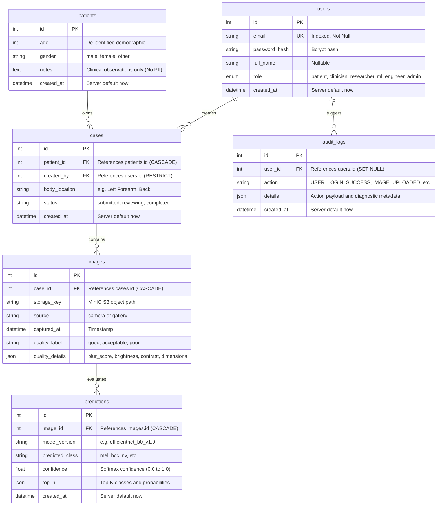

# DermAI Database Architecture & Schema

This document details the relational database design, table schemas, entity relationships, and privacy architecture for DermAI.

---

## 1. Entity-Relationship (ER) Diagram

---

## 2. Table Schemas & Data Dictionaries

### 2.1 `users` Table
Stores system user accounts, credentials, and role-based permissions.

| Column | Type | Constraints | Description |
|:---|:---|:---|:---|
| `id` | `INTEGER` | Primary Key, Indexed | Unique identifier for system account. |
| `email` | `VARCHAR(255)` | Unique, Indexed, Not Null | Account login email address. |
| `password_hash` | `VARCHAR(255)` | Not Null | Cryptographic salted hash generated via Bcrypt (Passlib). |
| `full_name` | `VARCHAR(255)` | Nullable | User display name or clinician title. |
| `role` | `ENUM` | Not Null, Default: `patient` | Allowed: `patient`, `clinician`, `researcher`, `ml_engineer`, `admin`. |
| `created_at` | `TIMESTAMP WITH TIME ZONE` | Not Null, Default: `now()` | Timestamp of account registration. |

---

### 2.2 `patients` Table
Holds strictly **de-identified demographic information** for patients. Designed in compliance with HIPAA and GDPR data minimization standards.

| Column | Type | Constraints | Description |
|:---|:---|:---|:---|
| `id` | `INTEGER` | Primary Key, Indexed | Internal anonymous patient record identifier. |
| `age` | `INTEGER` | Nullable | Patient age in years. |
| `gender` | `VARCHAR(50)` | Nullable | Biological sex / gender category. |
| `notes` | `TEXT` | Nullable | Relevant clinical history or symptoms (Strictly no PII). |
| `created_at` | `TIMESTAMP WITH TIME ZONE` | Not Null, Default: `now()` | Timestamp of initial patient intake. |

---

### 2.3 `cases` Table
Represents an individual clinical screening submission for a specific anatomical site.

| Column | Type | Constraints | Description |
|:---|:---|:---|:---|
| `id` | `INTEGER` | Primary Key, Indexed | Unique screening case tracking number. |
| `patient_id` | `INTEGER` | Foreign Key (`patients.id`), Not Null | Associated patient record. Deleting patient cascades deletion. |
| `created_by` | `INTEGER` | Foreign Key (`users.id`), Not Null | System user who created the case. `ON DELETE RESTRICT`. |
| `body_location` | `VARCHAR(100)` | Not Null | Anatomical site (e.g., *Left Forearm*, *Upper Back*, *Cheek*). |
| `status` | `VARCHAR(50)` | Not Null, Default: `submitted` | Workflow stage: `submitted`, `reviewing`, `flagged`, `completed`. |
| `created_at` | `TIMESTAMP WITH TIME ZONE` | Not Null, Default: `now()` | Timestamp of case submission. |

---

### 2.4 `images` Table
Tracks skin lesion photographs uploaded to MinIO S3 storage, along with automated image quality metrics.

| Column | Type | Constraints | Description |
|:---|:---|:---|:---|
| `id` | `INTEGER` | Primary Key, Indexed | Unique image record identifier. |
| `case_id` | `INTEGER` | Foreign Key (`cases.id`), Not Null | Parent screening case. Deleting case cascades deletion. |
| `storage_key` | `VARCHAR(500)` | Not Null | Object storage reference path (e.g. `cases/1/uuid.jpg`). |
| `source` | `VARCHAR(50)` | Not Null, Default: `camera` | Acquisition method: `camera` or `gallery`. |
| `captured_at` | `TIMESTAMP WITH TIME ZONE` | Not Null, Default: `now()` | Timestamp of photo acquisition/upload. |
| `quality_label` | `VARCHAR(50)` | Nullable | Automated classification: `good`, `acceptable`, or `poor`. |
| `quality_details` | `JSON` | Nullable | JSON payload containing `blur_score`, `brightness`, `contrast`, and `dimensions`. |

---

### 2.5 `predictions` Table
Stores inference outputs generated by deep learning classification models.

| Column | Type | Constraints | Description |
|:---|:---|:---|:---|
| `id` | `INTEGER` | Primary Key, Indexed | Unique prediction record ID. |
| `image_id` | `INTEGER` | Foreign Key (`images.id`), Not Null | Target lesion photograph. Cascades on image delete. |
| `model_version` | `VARCHAR(100)` | Not Null | Identifier of the neural model (e.g., `efficientnet_b0_v1.0`). |
| `predicted_class` | `VARCHAR(100)` | Not Null | Highest-probability diagnostic code (e.g., `mel`, `nv`, `bcc`). |
| `confidence` | `FLOAT` | Not Null | Softmax probability score ($0.0 \dots 1.0$). |
| `top_n` | `JSON` | Nullable | JSON array containing top-$K$ diagnostic candidates and scores. |
| `created_at` | `TIMESTAMP WITH TIME ZONE` | Not Null, Default: `now()` | Timestamp of inference execution. |

---

### 2.6 `audit_logs` Table
Provides an immutable audit log of critical access events, authentication activity, and clinical submissions.

| Column | Type | Constraints | Description |
|:---|:---|:---|:---|
| `id` | `INTEGER` | Primary Key, Indexed | Audit event identifier. |
| `user_id` | `INTEGER` | Foreign Key (`users.id`), Nullable | Acting user account. Set to `NULL` if user is removed or unauthenticated. |
| `action` | `VARCHAR(150)` | Not Null | Event type (e.g. `USER_LOGIN_SUCCESS`, `USER_LOGIN_FAILED`, `IMAGE_UPLOADED`). |
| `details` | `JSON` | Nullable | Structured diagnostic metadata (IP addresses, blur scores, email, reasons). |
| `created_at` | `TIMESTAMP WITH TIME ZONE` | Not Null, Default: `now()` | Timestamp of event occurrence. |

---

## 3. Privacy & De-Identification Architecture

To eliminate the risk of inadvertent Personal Health Information (PHI) exposure:
1. **Separation of Concerns**: User account records (`users`: email, full name, credentials) are decoupled from clinical patient records (`patients`: age, gender, notes).
2. **No Real Identifiers**: Patient records contain zero direct identifiers (no names, social security numbers, dates of birth, or addresses).
3. **Auditability**: All authentication failures, administrative actions, and uploads are tracked in `audit_logs` to ensure accountability under healthcare security frameworks.
