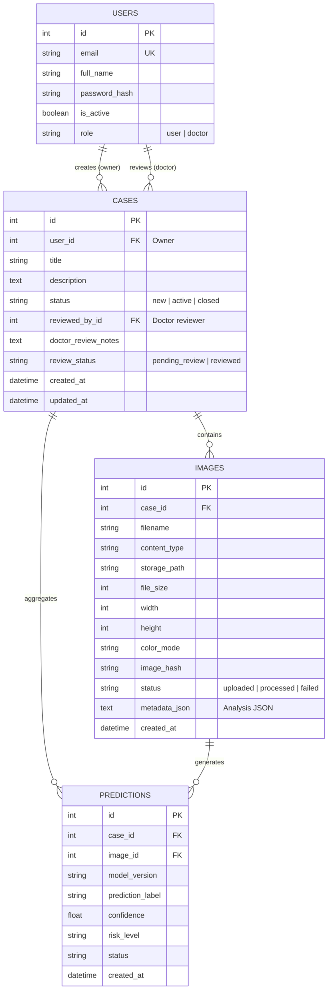

# DermAI — Database Schema & Data Dictionary

## 1. Overview
DermAI utilizes a PostgreSQL 16 relational database engine. All timestamps are standardized in UTC. Foreign key constraints enforce referential integrity with cascading updates where applicable.

---

## 2. Entity-Relationship Diagram

---

## 3. Detailed Data Dictionary

### 3.1 `users` Table
Stores authenticated credentials and role assignments.
| Column | Type | Constraints | Description |
|---|---|---|---|
| `id` | `INTEGER` | `PRIMARY KEY, AUTOINCREMENT` | Unique user identifier |
| `email` | `VARCHAR(255)` | `UNIQUE, NOT NULL, INDEXED` | Login email address |
| `full_name` | `VARCHAR(255)` | `NOT NULL` | Display name (e.g., "Dr. Arjun", "Varun") |
| `password_hash` | `VARCHAR(255)` | `NOT NULL` | Bcrypt salt + hashed credential |
| `is_active` | `BOOLEAN` | `DEFAULT TRUE, NOT NULL` | Account activity flag |
| `role` | `VARCHAR(50)` | `DEFAULT 'user', NOT NULL` | Access role: `'user'` (Patient) or `'doctor'` |

### 3.2 `cases` Table
Represents an individual clinical patient case / dermatological episode.
| Column | Type | Constraints | Description |
|---|---|---|---|
| `id` | `INTEGER` | `PRIMARY KEY, AUTOINCREMENT` | Unique case identifier |
| `user_id` | `INTEGER` | `FOREIGN KEY (users.id), NOT NULL` | Case owner (patient) |
| `title` | `VARCHAR(255)` | `NOT NULL` | Short descriptive title of the condition |
| `description` | `TEXT` | `NULLABLE` | Patient clinical history or symptoms |
| `status` | `VARCHAR(50)` | `DEFAULT 'new', NOT NULL` | Lifecycle state (`new`, `active`, `closed`) |
| `reviewed_by_id` | `INTEGER` | `FOREIGN KEY (users.id), NULLABLE` | Doctor who reviewed the case |
| `doctor_review_notes`| `TEXT` | `NULLABLE` | Clinical remarks entered by physician |
| `review_status` | `VARCHAR(50)` | `DEFAULT 'pending_review'` | Clinical review state |
| `created_at` | `TIMESTAMP` | `DEFAULT NOW(), NOT NULL` | Timestamp of case submission |
| `updated_at` | `TIMESTAMP` | `DEFAULT NOW(), ON UPDATE NOW()` | Last update timestamp |

### 3.3 `images` Table
Metadata and results for uploaded dermoscopic images.
| Column | Type | Constraints | Description |
|---|---|---|---|
| `id` | `INTEGER` | `PRIMARY KEY, AUTOINCREMENT` | Unique image record identifier |
| `case_id` | `INTEGER` | `FOREIGN KEY (cases.id), NOT NULL` | Associated case |
| `filename` | `VARCHAR(255)` | `NOT NULL` | Safe sanitized filename |
| `content_type` | `VARCHAR(100)` | `NOT NULL` | Verified MIME type (`image/jpeg`, `image/png`) |
| `storage_path` | `VARCHAR(500)` | `NOT NULL` | File path relative to uploads directory |
| `file_size` | `INTEGER` | `NOT NULL` | File size in bytes |
| `width` | `INTEGER` | `NULLABLE` | Image width in pixels |
| `height` | `INTEGER` | `NULLABLE` | Image height in pixels |
| `color_mode` | `VARCHAR(50)` | `NULLABLE` | Color space (`RGB`, `L`, etc.) |
| `image_hash` | `VARCHAR(128)` | `NULLABLE` | SHA256 digest for duplicate detection |
| `status` | `VARCHAR(50)` | `DEFAULT 'uploaded', NOT NULL` | Processing state |
| `metadata_json` | `TEXT` | `NULLABLE` | Serialized full analysis payload |
| `created_at` | `TIMESTAMP` | `DEFAULT NOW(), NOT NULL` | Upload timestamp |

### 3.4 `predictions` Table
Structured queryable historical index of model inference results.
| Column | Type | Constraints | Description |
|---|---|---|---|
| `id` | `INTEGER` | `PRIMARY KEY, AUTOINCREMENT` | Unique prediction record identifier |
| `case_id` | `INTEGER` | `FOREIGN KEY (cases.id), NOT NULL` | Associated case |
| `image_id` | `INTEGER` | `FOREIGN KEY (images.id), NULLABLE` | Associated image |
| `model_version` | `VARCHAR(100)` | `NOT NULL` | Model identifier used for inference |
| `prediction_label` | `VARCHAR(100)` | `NULLABLE` | Predicted diagnostic class code |
| `confidence` | `FLOAT` | `NULLABLE` | Predicted confidence probability $[0.0, 1.0]$ |
| `risk_level` | `VARCHAR(50)` | `NULLABLE` | Assigned risk level |
| `status` | `VARCHAR(50)` | `DEFAULT 'pending', NOT NULL` | Inference status |
| `created_at` | `TIMESTAMP` | `DEFAULT NOW(), NOT NULL` | Timestamp of prediction |

---

## 4. Migrations & Table Creation
Table definitions are synchronized via SQLAlchemy's declarative metadata (`Base.metadata.create_all(bind=engine)`), executed safely at application startup.
